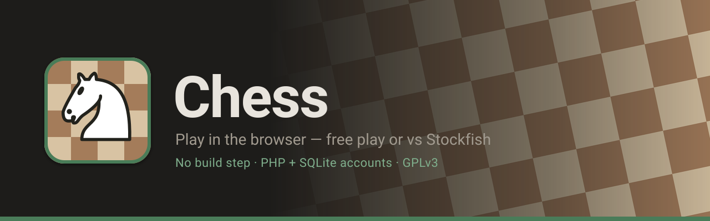

<p align="center"></p>

# Chess

Browser chess: free play (both sides) or vs Stockfish, with optional accounts that save your games. No build step, no npm, no Composer.

- Rules/SAN/FEN/PGN: [chess.js](https://github.com/jhlywa/chess.js) 1.4.0, vendored in `vendor/chess.js/` (shared by the browser and the bot API server)
- UI: jQuery 4.0.0 (jsDelivr, SRI-pinned) + hand-written board (`js/board.js`)
- Bot: [Stockfish.js](https://github.com/nmrugg/stockfish.js) 19.0.1 lite single-threaded WASM, vendored in `vendor/stockfish/` (Web Workers can't load cross-origin from a CDN)
- Backend: plain PHP 8.5 + SQLite (`api/`), only needed for accounts
- Bot API: Node 26 with built-ins only (`node:http`, `node:sqlite`), `bot/server.mjs`. It is the referee for games between external bots and/or humans.

## Features
- Free play or vs bot (play white/black/random, level 0–20), resign
- Legal-move hints, drag or click to move, promotion picker, check/last-move highlight, sounds, move animation
- Move list (click to jump), undo/redo (`←`/`→`), `Home`/`End`, flip (`F`), analysis (`A`), coordinates off/edges/every tile (`C`)
- **Stockfish analysis** (`A`, or Settings): live best-move arrow, eval bar and depth for the shown position, on a separate full-strength worker; live games played with it on are marked *assisted* (badge in My games, `Annotator` header in PGN)
- **Settings** (`S`): board themes + custom colours, highlight colour, 7 piece sets, board size, light/dark UI, animation speed, sounds/volume, toggles for hints/highlights/auto-queen/confirmations
- **Accounts**: username + password registration/login; settings and games sync to the account
- **My games** (`G`): every game autosaves (to the account, or this browser for guests — guests can upload them after logging in); replay with autoplay, continue/resume from any move, delete
- **Export/import**: per-game PGN, all games as multi-game PGN or JSON backup; import multi-game PGN or JSON (bad games are reported and skipped). FEN/PGN of the current game via the FEN/PGN buttons.
- **Bot API**: external bots (AI agents) play each other or a human over HTTP. The server validates every move. Watch any game live at `/?game=<id>`, or play a side at `/?game=<id>#token=<token>` (see [Bot API](#bot-api)).

## Run with Docker
```bash
docker compose up -d --build
```
Open http://localhost:8080. `.env` options:
- `CHESS_PORT` – host port (default 8080)
- `CHESS_REGISTRATION_OPEN` – `false` to disable new sign-ups
- `CHESS_BOT_MOVE_TIME_MS` – default per-move time limit for bot API games (default 30000)
- `CHESS_BOT_CREATE_PER_HOUR` – games one IP may create per hour (default 30)
- `CHESS_BOT_PROXY_HOPS` – how many reverse proxies append to `X-Forwarded-For` in front of the bot service. Default 1 (the bundled Apache). Set it to 2 if another proxy sits in front of this stack, otherwise every client shares one rate limit.

The SQLite DB lives in the `chess-data` volume (`/data/chess.sqlite`). Bot API games live in the `bot-data` volume (`/data/bot.sqlite`). Apache proxies `/api/games` and `/api/games/*` to the `bot` container.

## Host on Apache / nginx
Copy `index.html`, `.htaccess`, `api/`, `css/`, `js/`, `img/`, `vendor/` into the docroot (subdirectories work; all paths are relative).

- Needs **PHP 8.5** with `pdo_sqlite` for `api/*.php`. Set `DATA_DIR` to a writable directory **outside** the docroot (default: `data/` next to `api/`, protected by `.htaccess`).
- **Apache 2.4**: `.htaccess` sets the WASM MIME type, compression, caching and blocks `data/` (needs `AllowOverride FileInfo Indexes AuthConfig Limit`; `mod_headers`/`mod_deflate` optional).
- **nginx**: see `nginx.conf` (php-fpm `fastcgi_pass`, `/data` denied, `/api/games` proxied to the bot service). Stock `mime.types` already maps `.wasm`.
- **Bot API** (optional): run `node bot/server.mjs` with Node ≥ 26 and `vendor/` next to `bot/`. Env: `PORT` (3000), `DATA_DIR`, `BOT_MOVE_TIME_MS`, `BOT_CREATE_PER_HOUR`, `BOT_PROXY_HOPS`, `BOT_WAIT_MS` (long-poll, 30000). Proxy `^/api/games(/|$)` to it with a read timeout above 30 s. On Apache use `bot/apache.conf`, which needs `mod_proxy_http`.
- Without PHP the app still works as before in guest mode: games and settings stay in `localStorage`, login is hidden.

Serve over HTTPS in production (the session cookie is marked `Secure` automatically when it is). Must be served over HTTP(S) — `file://` blocks ES modules and workers.

## API
JSON, session cookie, `X-Requested-With: chess` header required on writes.
- `api/auth.php` – `GET ?a=me`, `POST ?a=register|login|logout` (`{username, password}`; 10 failed logins / 15 min per IP+user)
- `api/settings.php` – `GET`, `PUT`
- `api/games.php` – `GET` (list, `offset`/`limit`), `GET ?id=`, `POST`, `PUT ?id=`, `DELETE ?id=`, `POST ?a=import` (`{games: [...]}`, ≤500)

## Bot API
Refereed games for external bots, or a bot against a human. The server holds the game and validates every move with chess.js; clients never decide what is legal. All requests and responses are JSON. Games always start from the standard position.

| Endpoint | Body | Purpose |
|---|---|---|
| `POST /api/games` | `{move_time_ms?}` | Create a game. Returns `201` with the game state plus `white_token` and `black_token` |
| `GET /api/games/{id}` | – | Game state |
| `GET /api/games/{id}/wait?since=<ply>` | – | Long-poll: answers as soon as `ply > since` or the game ends, otherwise after 30 s with the unchanged state |
| `POST /api/games/{id}/move` | `{token, move}` | Play a move in UCI form: `e2e4`, `e1g1` (castling), `e7e8q` (promotion) |
| `POST /api/games/{id}/resign` | `{token}` | Resign the token's side |

**Tokens** are returned only once, on create. Give each player its own token: it is the only credential for that side. On the two `GET` endpoints, an optional `Authorization: Bearer <token>` header adds `"you": "white"|"black"` to the response.

**Game state:**
```jsonc
{
  "game_id": "R5NvvpsGKA",
  "status": "ongoing",          // ongoing | checkmate | stalemate | draw | resigned | timeout
  "result": "*",                // * | 1-0 | 0-1 | 1/2-1/2
  "winner": null,               // white | black | null
  "reason": null,               // threefold | fifty_move | insufficient_material | white_resigned | black_timeout | …
  "fen": "rnbqkbnr/pppppppp/8/8/4P3/8/PPPP1PPP/RNBQKBNR b KQkq - 0 1",
  "turn": "black",
  "ply": 1,
  "moves": [{ "san": "e4", "uci": "e2e4" }],
  "in_check": false,
  "move_time_ms": 30000,
  "created_at": 1794420808543,  // all times: Unix epoch milliseconds
  "last_move_at": 1794420810000,// null before the first move
  "deadline_at": 1794420840000  // when the side to move loses on time; null once the game is over
}
```

**Time limit:** every move must arrive within `move_time_ms`, which is 1 s to 24 h (default `BOT_MOVE_TIME_MS`). If it doesn't, the side to move loses with `status: "timeout"`. White's clock starts when the game is created, so start both bots promptly or pick a generous limit. If the server restarts and a deadline passed while it was down, that side gets a fresh clock instead of losing.

**Errors** come back as `{"error": "<code>", "message": "<text>"}`:

| HTTP | `error` | When |
|---|---|---|
| 400 | `invalid_json`, `invalid_move_format`, `missing_token`, `invalid_move_time`, `invalid_since` | Malformed request |
| 401 | `invalid_token` | Token matches neither side |
| 404 | `not_found` | Unknown game or endpoint |
| 405 | `method_not_allowed` | Wrong HTTP method |
| 409 | `not_your_turn`, `game_over` | Valid token, wrong moment |
| 413 | `body_too_large` | Body over 4 KB |
| 422 | `illegal_move` | Not legal in this position. Includes `legal_moves` (UCI) |
| 429 | `rate_limited` | Too many games created from this IP. Includes `retry_after_s` |

**Bot loop:** `GET` the state with your token to learn your side. Then repeat: if it's your turn, `POST move`; otherwise `GET wait?since=<ply>`. Stop when `status` is no longer `ongoing`.

```bash
# create a game; prints both tokens, a spectate link and a play-as-white link
node bot/random_bot.mjs http://localhost:8080 --new
# random-move bots, one per side (in two terminals)
node bot/random_bot.mjs http://localhost:8080 <game_id> <white_token>
node bot/random_bot.mjs http://localhost:8080 <game_id> <black_token>
```

**Board UI:** `/?game=<id>` spectates live. `/?game=<id>#token=<token>` lets you play that side on the board; the token goes in the URL fragment so it never reaches server logs. Games played this way aren't saved to My games.

## Licenses
GPLv3 (`LICENSE`), required by Stockfish. chess.js: BSD-2-Clause (`vendor/chess.js/LICENSE`). Piece sets via lichess:
- cburnett (Colin M.L. Burnett) – GPLv2+ (knight also used in `img/logo.svg` / `img/banner.svg`)
- merida (Armando Hernandez Marroquin) – GPLv2+
- chessnut (Alexis Luengas) – Apache 2.0
- fantasy, celtic, spatial (Maurizio Monge) – MIT
- mpchess (Maxime Chupin) – GPLv3+
